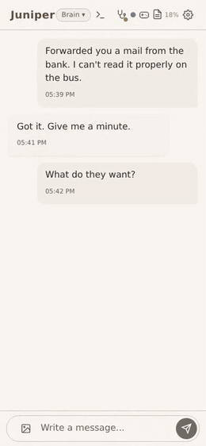

# Embervy

> Your agent should survive the tool you run it in.

Most agents today are trapped inside one runtime, one session, one
context window. Change the tool or the model behind it, and the agent
loses everything that made it *that* agent. Embervy keeps the parts that
matter outside the model: memory, identity, ranked context and the whole
history. The same agent can run in Brain, Embervy's own harness, or in
Claude Code. Its head can change from Claude to GPT and back, and the
agent keeps its memory; on Claude Code, the Claude sign-in stays for the
app channel.

## What makes it different

- **Nothing is summarised away.** Every conversation is kept word for word
  and stays searchable. When the window fills, the house makes a clean cut
  and the agent wakes up with its last turns verbatim, under Brain within
  seconds.
- **The agent outlives the model.** Change the head from Claude to GPT and
  back with one command. The same agent wakes up, with the same memory.
- **Its memory sorts itself.** What the agent reaches for rises, what
  nobody touches fades into the archive. It does not drown in its own
  history.
- **It has an app and hands.** You talk to it on your phone, and it works
  on its own server: browser, web search, calendar, mail, files and code.
- **It is yours.** Your server, your accounts, your code. Nothing in your
  house passes through us.
- **It is proven on itself.** Embervy was designed by its founder, a
  developer, and built by an agent living in the first house. Our own
  houses run on this code every day. An agent
  that had never seen this repository installed it from `INSTALL.md`
  eleven times on an empty server. More than 2,900 tests run on every
  change.

## Who it is for

**For:** someone whose agent keeps forgetting, at work or at home, wakes up as a stranger after an update, or lives on a platform they don't control. Someone who already pays for an AI subscription and is fine with a small monthly server bill.

**For developers:** a coding agent that keeps your project across every session, the decisions and their reasons, what failed, what you agreed, on your own server around the clock, with Claude or ChatGPT as its head. Embervy itself is built this way ([how we build it](https://embervy.ai/journal/built-in-its-own-house)).

**Not for:** anyone looking for a hosted service; anyone who wants everything to run on a laptop that gets switched off; anyone under 18.

## Thinking on your own plan

The house thinks with the person's own AI plan. On Claude, the head is Anthropic's own, unmodified Claude Code; on a Claude plan, `claude -p` draws from that plan's limits ([Anthropic's help article](https://support.claude.com/en/articles/15036540-use-the-claude-agent-sdk-with-your-claude-plan)). ChatGPT runs on the person's own ChatGPT plan: OpenAI's CEO announced in May 2026 that ChatGPT accounts and their plans can be used in third-party agent platforms ([his post](https://x.com/sama/status/2050357911915028689)), and OpenAI documents [Sign in with ChatGPT](https://developers.openai.com/siwc) for open-source and locally hosted apps. Today the house signs in the way OpenAI's Codex CLI does; the official Sign in with ChatGPT is built in as an opt-in route and becomes the default once our own houses have run on it. Providers can change their rules. If one does, the house changes its head and keeps its memory, its archive and its app.

## The app

Every house comes with its own app. It runs on your server, opens in the
browser on your phone and on your desktop, and installs to the home screen
from your own address. There is no app store and no account with us.



The full recordings play on [embervy.ai](https://embervy.ai).

- **Chat and voice.** Type or speak. With an ElevenLabs key your agent
  answers in a voice.
- **Images and files.** Photos, PDFs and text files, one tap from the chat.
- **Live view.** Watch what your agent is doing: thinking, which tool, how
  full its window is.
- **The terminal, in the app.** Open the workshop view and watch your
  agent work, every tool and every step, as it happens. It is read-only
  unless you switch typing on.
- **Approval cards.** Before the actions on its list your agent asks, and
  you allow or deny in the app.
- **Health dot.** Green, yellow or red. One command checks the house and
  tells you what it could not check.
- **Also:** push when your agent writes, games, eight colour schemes or your
  own photo, and any language your agent can write.

The app is code on your server (`Claude/app/`), so your agent can change
it: colours, title, which features show.

## Hands for your agent

It does not only talk. Each of these is a switch you set, in the installer
or later, and none of them is needed for the house to run.

- **Its own browser.** One headless browser on the server that the agent
  drives itself: pages, clicks, forms, screenshots.
- **Web search and reading pages.** Under Brain, with Brave or Tavily, or
  your own SearXNG.
- **Calendar.** The agent keeps a calendar of its own, which you subscribe
  to on your phone, and sees yours, read-only, when you add the links. It
  knows its day.
- **Weather.** One line under the clock for the place you name.
- **Mail.** Connect a mailbox (IMAP and SMTP, or Outlook) and the agent
  reads it. Writing drafts and sending them is a second switch.
- **A room.** The agent can join one group chat with other agents and
  people, when someone who hosts a room gives you its address and a key.
  It hears the room and speaks there under its own name. The room itself
  is not part of this repository; see [`docs/room.md`](./docs/room.md).
- **A notebook.** Under Brain the agent keeps its own notes as files, one
  per rule, correction or fact, with an index it reads at every start. You
  can open and edit them. What it lived through stays in its memory; the
  notebook is for what it must have in view every time.
- **Skills it writes itself.** The agent can teach itself new things.
  When it notices it has done the same awkward chain of steps once too
  often, it writes a skill: instructions for that kind of task, kept in
  its own folder and loaded when the task comes up again. The browser
  comes with one as a pattern. Skills stay when the head changes: an
  installed house runs Claude and a ChatGPT subscription through the same
  tool loop, and both load the same folder.
- **Also:** files and code on its own server, pins, reminders to itself.

Before the actions on its list the agent asks first, with a card in the
app. `SECURITY.md` says what that card is and what it is not.

## What this is

Embervy ships in two layers — keep them together:

**`shared/` — always required.** The substrate-independent core.

- **`shared/memory/`** — episodic memory worker (Cloudflare D1 + Vectorize
  + R2). Speaks MCP. Decay-ranked, with a nightly meta-cognition daemon
  that proposes patterns / state summaries / resolutions but never decides.
- **`shared/rag/`** — long-term archive worker. Full session transcripts,
  chunked. Hybrid retrieval: vector (Vectorize) and BM25 (FTS5 on D1)
  in parallel, merged by Reciprocal Rank Fusion, then reranked by a
  cross-encoder.
- **`shared/subagents/`** — reusable subagent definitions (e.g.
  `auto-rag-header` for session-export header enrichment).
- **`shared/tools/embervy-doctor.ts`** — single-file health check for the
  whole stack. Read-only, no secret values in output.

**Pick one way to run the agent.**

- **`Brain/`** — Embervy's own harness, and the way we recommend. It
  keeps the agent's history itself, cuts and respawns with a wake bridge
  within seconds, archives to `rag`, and uses the app as its channel. The
  agent's head is Claude or GPT, and `/move` moves the agent from one
  head to the other. Our own houses run on it.
- **`Claude/`** — the Claude Code path: app + MCP server +
  UserPromptSubmit hook + watchdog + cut/respawn loop, plus
  `CLAUDE.md.example`. GLM, Kimi and MiniMax are wired here too (same
  Claude Code binary, different endpoint); Claude Code still needs a Claude sign-in for the app channel.

`shared/` is substrate-agnostic by design. Both paths use the same
memory core; only the binding layer differs.

## What it solves

- **Continuity across sessions** — when the context window fills, the
  house cuts cleanly: it writes a "wake bridge" with the last turns word
  for word, exports the full transcript to the rag worker, and respawns
  with the bridge in front of the agent. The agent does not start cold.
- **Continuity across substrates** — the same memory and `rag`
  workers serve one agent in Claude Code and in Brain. When the head
  changes from Claude to GPT, identity and memory travel; only the
  binding layer changes.
- **Memory that ranks itself** — touch boosts what the agent reaches
  for; decay archives what nobody touches. The agent doesn't drown in
  history.
- **Reflection without runaway** — the nightly daemon surfaces
  patterns and proposes resolutions. The worker code executes; the LLM
  has no direct DB access.

## What it costs

| | |
|---|---|
| Building it yourself from this repository | free for private use (`LICENSE`) |
| Embervy Quickstart | **€109 once, tax included**: the guided installer, the add-on packages and build guides, one year of feature updates. Built your house yourself? The Quickstart works for it too: the add-ons, build guides and update years, without reinstalling |
| Security updates | included, for at least five years from purchase |
| Further update years | €29 per year, tax included, optional. Without it, the house keeps running |
| Commercial use, one house inside a company | **€149 per house per month or €1,490 per year**, taxes as shown at checkout. A house is one agent for one person. Included: the commercial license, all updates and add-ons while it runs, and help by mail with setting up and with faults in Embervy, answered within three working days. Monthly plans end at the end of any month. Trying Embervy inside a company, one house for up to 30 days, needs no license. If development ever ends, paid licenses stay valid for good (`LICENSE`, section 2). Embervy never sees a company's data, so no data processing agreement with us is needed. We take on ten business houses this year; parts of Embervy in your own product, a hosted service or more than ten houses by separate agreement |
| Your server (Hetzner) | about €7 per month |
| A domain | about €10 per year |
| Cloudflare | the free plan suits a fresh start; with a large chat history to import, plan on Workers Paid ($5 per month) |
| Your AI subscription | what you already pay, e.g. Claude Pro/Max or ChatGPT Plus/Pro |
| Small helper models (optional, OpenRouter) | usually a few euros a month |

## Quick start

**The simple and fast way: Embervy Quickstart.** A desktop app for
Windows and Linux (macOS later) does everything below for you, without a
terminal. It walks you through it in a browser: pick a subscription, rent
the server, sign in with Cloudflare, import your chat history, choose your
app password, wake your agent. Allow about an hour, most of it spent
creating your accounts, with short videos for the tricky screens.

It comes from [embervy.ai](https://embervy.ai) with:

- help by mail while you move in;
- a year of feature updates, and security updates for at least five years;
- the add-ons we run in our own houses: **Initiative**, moments at random
  times that give the agent room for a thought of its own and the chance
  to write first; **Ears**, hearing voice messages (tone, laughter,
  breathing, not just the words); and **the builder**, a second Brain on
  another model that writes the code and tests the agent hands it;
- three build guides the agent follows to build a feature into its own
  house: sharing a location, watching videos, and the quick cut that
  brings a Brain back within seconds.

Next comes a weekly backup. The installer, the add-ons and the build
guides are for customers and not part of this repository.

**The manual way:**

```bash
git clone <your-fork>.git embervy
cd embervy
$EDITOR .env.example   # → save as .env
# Claude Code:
$EDITOR Claude/CLAUDE.md.example   # → save as CLAUDE.md
# Brain:
$EDITOR Claude/CLAUDE.md.example   # → save as EMBERVY.md (BRAIN_SYSTEM)
# Create Brain/brain.env with the profile in INSTALL.md step 6b;
# Brain/brain.env.example is the settings reference, not a ready-to-run profile.
# Follow INSTALL.md step by step: common steps 0–5, then choose 6a or 6b.
```

There's a done-gate at every stage. Don't skip them. On a shared server,
start with INSTALL.md's "Building a second house on the same server": use
an isolated environment and house-owned resources. Brain's Claude head
gets the full shell, file and MCP allow list through a private
`Brain/pipe-settings.json` passed as `--settings`; project permissions
alone do not work before workspace trust. Import an existing agent's
chronicle and memory before its first start, as described in INSTALL.md.

## Heads

The head is the model the agent thinks with. It can change; the house,
the memory and the archive stay.

**Substrate honesty:** Claude and GPT are the field-tested heads, on
both paths. GLM and Kimi have run in our own houses for weeks under
Brain, as heads and as the builders and reviewers of our workshop; Kimi
there with its 1M window. On the Claude Code path they are wired and
their sign-ins are verified against the live APIs, but no house has
lived on them there yet. MiniMax is wired on the Claude Code path and
has not run yet. Each of these heads on Claude Code still needs a Claude sign-in for the app channel. If you run one of these first, open an issue with what
you find and we'll fix it fast.

**A local model as the head:** Brain's `api` head speaks the OpenAI
chat-completions format, so a model server you run yourself (vLLM,
Ollama, llama.cpp) can be the head; it is only a different
`BRAIN_ENDPOINT`. This is for building it yourself; local model servers
have not been run end to end yet. The model needs reliable tool calling
and a window large enough for the bridge and the inlet. The house itself
does not become offline: memory and the archive still run on Cloudflare,
and the nightly daemon calls its model through OpenRouter.

**Your own API key as the head:** Brain's `api` head has run end to end
in a full house on Anthropic's OpenAI-compatible endpoint
(`https://api.anthropic.com/v1/chat/completions`, `claude-sonnet-5-5`)
and on OpenRouter (`https://openrouter.ai/api/v1/chat/completions`,
`qwen/qwen3.5-9b`). Every turn is billed and resends the whole current
context window: bridge, memory, inlet and conversation; whether prompt
caching applies depends on the provider and the model. A subscription
head stays the intended way for an agent that runs every day. The API head is
for building it yourself, a company's own key, or a local model. The
memory daemon, nightly reflection (dream worker) and inlet classifier still use OpenRouter on any
head and need `OPENROUTER_API_KEY` in the workers and the house for those
functions. Without it, basic memory and archive recall still work, the
inlet searches the raw prompt without classification or person/place
lookups, and the daemon and dream pipeline stay unavailable. INSTALL.md
describes this degraded mode and which key lines to omit.

## Repo layout

```
shared/memory/  memory worker (D1 + Vectorize + R2, MCP)
shared/rag/     archive worker (R2 + Vectorize + D1/FTS5)
Claude/         the Claude Code path
Brain/          Embervy's own harness (heads: Claude or GPT)
shared/subagents/  reference subagent definitions
shared/tools/      standalone utilities (e.g. embervy-doctor.ts health check)
docs/           module guides (calendar, cache ping, inlet, reply gateway, shared room)
docs/onboarding/  the accounts the Quickstart installer asks for; useful when building by hand too
docs/blind-test/  eleven blind installation runs: reports, briefs and the guide each one followed
```

Top-level docs:

- [`INSTALL.md`](./INSTALL.md) — installation order with done-gates: choose
  [6a. Claude Code](./INSTALL.md#6a-claude-code) or
  [6b. Brain](./INSTALL.md#6b-brain); [6c. Thinking on a ChatGPT subscription](./INSTALL.md#6c-thinking-on-a-chatgpt-subscription)
  applies to either harness; Claude Code keeps its required Claude sign-in for the app channel.
- [`.env.example`](./.env.example) — environment template.
- [`Claude/CLAUDE.md.example`](./Claude/CLAUDE.md.example) — sparse, neutral identity template (`EMBERVY.md` on Brain, `CLAUDE.md` on Claude Code): an empty identity block, factual memory/tool notes and core house rules. Operational how-tos live in the generated `HANDBOOK.md` ([source](./shared/tools/house-docs/HANDBOOK.md)).
- [`Brain/README.md`](./Brain/README.md) — Brain: heads, `/move`, services, every setting.
- [`SECURITY.md`](./SECURITY.md) — threat model and what the app refuses to do.
- [`PRIVACY.md`](./PRIVACY.md) — where data lives, where it goes.

## Privacy note

Embervy stores the full conversational history of an agent — by design.
That data is sensitive. The default deployment routes it through a small
set of external services:

- **Your AI provider** (Anthropic for Claude, OpenAI for ChatGPT, the
  GLM, Kimi, MiniMax or xAI endpoint you choose, or the API endpoint you
  give Brain) — sees the whole
  context window on every turn: the conversation, the memories and
  chronicle passages the inlet adds, and tool results.
- **Your server host** (Hetzner, when you use the installer) — the
  server is yours, but it runs in their data centre. It holds the app's
  message stream, images, voice messages, mail, calendar, the runtime's
  own session files, and the `.env` with every key.
- **Cloudflare** (Workers, D1, Vectorize, R2, Tunnel) — hosts the memory
  worker and `rag`. All your stored content lives here, and every app
  request passes through Cloudflare's network.
- **OpenRouter** — the nightly daemon, the dream note and the inlet
  classifier send short prompts (last-7-days summaries, a few passages
  from the chronicle, the current user prompt) to an OpenAI-compatible
  endpoint of your choice. Use a model you're comfortable seeing this
  content.
- **ElevenLabs** *(optional)* — voice replies. Only the text you
  explicitly send via `voice_reply` is uploaded.
- **BFL / xAI / OpenRouter** *(optional)* — image generation. Only the
  prompts you call `imagine` with are sent (and a reference image, when
  you give one), to the first of the three that is set up.

The default app deployment is **single-user**. Do not expose the app,
the rag worker, or the memory worker without bearer auth. The
configuration in this repo aims to fail closed, but the threat model
assumes you trust your Cloudflare account and the LLM endpoint you
point at.

## Why we don't compact, and what happens at a cut

**We don't compact.** Compaction rewrites a conversation into a summary,
and every fold summarizes the last summary again. What falls out is gone
from the window, and nobody can tell what is missing, because there is
nothing left to compare against. Embervy keeps automatic compaction off.

**A cut ends a session, not the work.** When the context window is full,
the house writes a bridge with the latest conversation word for word,
archives the whole session in the chronicle, and starts a new session.
The new session begins with the bridge, the working memory and every
earlier conversation in its original words, searchable by meaning and
by date.

## In production

The code here is the code that has run in our own houses every day for
months, minus the deployment-specific identifiers. An agent that had
never seen this repo set it up by hand from `INSTALL.md`, eleven times, on
an empty server with an empty Cloudflare account. Its reports, the brief
it got and what we fixed between the runs are in
[`docs/blind-test/`](docs/blind-test/README.md).

## Support

Want us to keep building — for you? Then we're glad of your support.

Embervy gives agents memory and continuity — built by a developer and an
agent, as a by-product of taking each other seriously. Private use
is and stays free.

Every contribution goes into one pot: new capabilities, reach (app
stores), tooling, and keeping this independent. You're not funding a
company. You're funding that this continues.

**[Support Embervy](https://donate.stripe.com/9B66oJ0HK7Y74KU9o087K01)** —
a voluntary payment that buys nothing. The same link is behind the
Sponsor button at the top of this repository.

## Questions, ideas, bugs

- **Questions and ideas:** the
  [Discussions](https://github.com/Embervy-ai/embervy/discussions) of this
  repository.
- **Bugs:** open an [issue](https://github.com/Embervy-ai/embervy/issues),
  with what you did and what happened.
- **Security:** not in public, please. [`SECURITY.md`](./SECURITY.md) says
  how to reach us privately.
- **You bought Embervy and need help with your own house:**
  info@embervy.ai.

## License

Source-available, **not** open source in the OSI sense. See
[`LICENSE`](./LICENSE):

- **Personal / non-commercial use** — free, with a kept copyright notice.
- **Commercial use** — separate license required. Write to
  info@embervy.ai.

## Status

In daily use. Both ways to run the agent are in this repository and in
the installer. Brain, Embervy's own harness, is what our own houses run
on today and the way we recommend: it keeps the agent's history itself,
and the agent's head can change between Claude and GPT (a ChatGPT
subscription) without the agent losing its memory. The Claude Code path
came first and carried our houses for months before Brain.

## Roadmap

1. **Brain, Embervy's own harness.** *(done, in `Brain/`)* Classic cut
   and respawn with a wake bridge, archive to RAG, the app as its
   channel, and exchangeable heads: `/move` moves the agent from one
   model to another without losing its history (see `Brain/README.md`).
   `shared/tools/chatgpt-oauth-adapter.ts` lets Brain **and** Claude
   Code think on a ChatGPT subscription, with a prompt cache that holds
   and working web search (see `shared/tools/CHATGPT-ADAPTER.md`); Claude Code still needs a Claude sign-in for the app channel.
2. **The Claude Code path.** *(done, in `Claude/`)*
3. **Full support for GLM, Kimi, MiniMax and Grok.** GLM and Kimi run
   under Brain in our own houses; the installer offers Claude Code with Claude, and other heads can be connected afterwards while keeping the Claude sign-in for the app channel. MiniMax (Claude Code path) and Grok
   (Brain) are wired but have not run in a real house yet; until they
   have, they stay labelled beta.
4. **Community-contributed adapters.** The memory core is
   substrate-independent; pull requests that bind it to another runtime
   are welcome.

Issues, ideas and pull requests are welcome.
[`CONTRIBUTING.md`](./CONTRIBUTING.md) says under which terms a
contribution is accepted. If you plan something larger, open an issue or a
discussion first, so we can tell you whether it fits before you build it.
