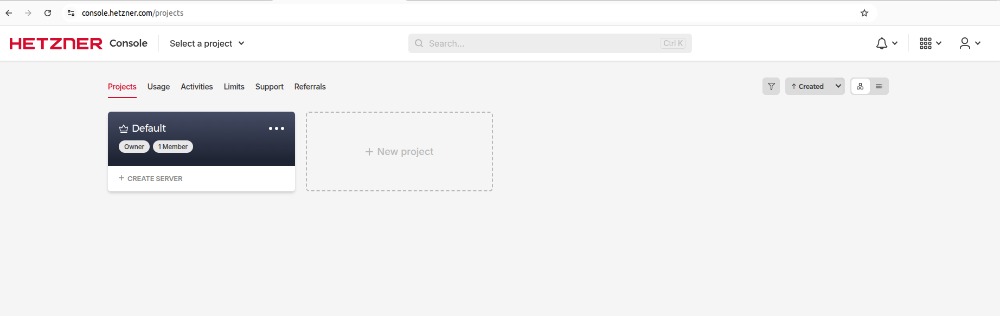
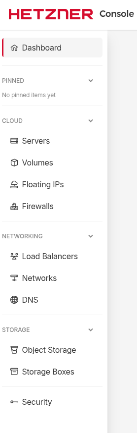
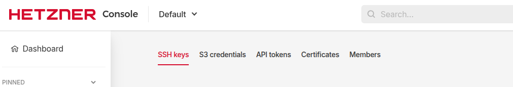
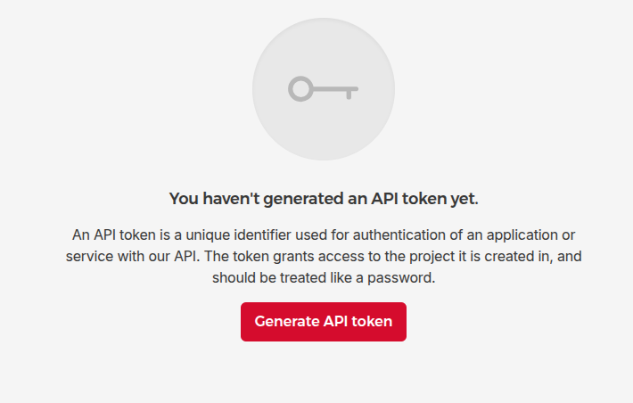
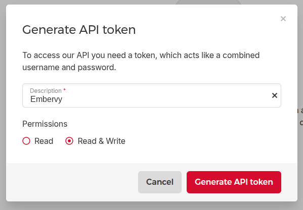
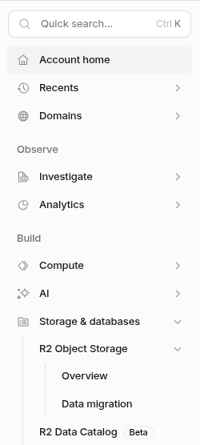
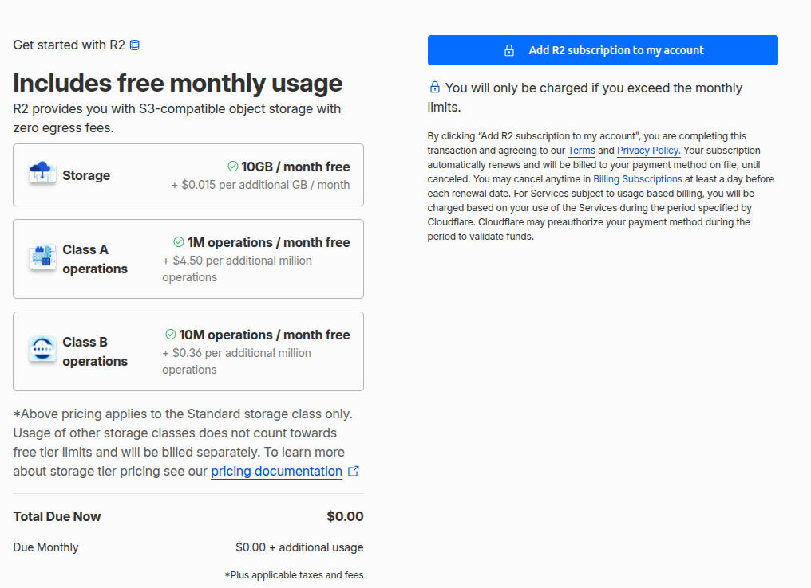
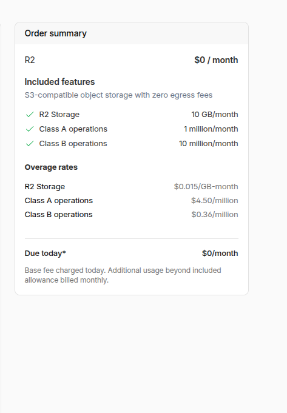

# Before you run the installer — the two accounts

The installer does everything it can by itself. Two things only you can
do, because they involve **agreeing to pay someone**: creating the account
where your agent's server lives (Hetzner) and the account where its memory
lives (Cloudflare). Both take about five minutes. Every screenshot below
is from a real first-time run — what you see is what you'll get.

**Total cost reality:** ~€7/month for the server (hourly billing, delete
anytime), €0/month for the memory on Cloudflare's free tier (a payment
method on file is required for R2, but 10 GB are free — that's thousands
of conversations). Big imported histories may need Workers Paid ($5/month);
the installer tells you if yours does.

---

## 1. Hetzner — where your agent lives

Use the Cloud Console at https://console.hetzner.cloud (not konsoleH or Robot).
Create a new project there. If you already have a server at Hetzner, open
the project it is in instead: a token only sees its own project, and the
installer can use that server. Servers in other projects are not touched.

Sign up if needed (requires a payment method — card or PayPal).
Open your new project:

You do NOT create a server yourself — the installer does that. All it
needs is one API token. In the left sidebar, scroll down to **Security**:

Inside Security, open the **API tokens** tab:

You'll see this — click **Generate API token**:

Name it `Embervy`, set permissions to **Read & Write**, generate:

**Copy the token immediately — it is shown only once.** Paste it into the
installer's server step. That's Hetzner done: the installer creates the
server, sets it up, and you never touch this console again (except to
delete the server if you ever want out — billing stops the same hour).

---

## 2. Cloudflare — where your agent's memory lives

**Create an account** at [dash.cloudflare.com/sign-up](https://dash.cloudflare.com/sign-up)
(email + password, verify the email). The free plan is all you need to start.

**One manual step: enable R2** (the file storage for long-term memory).
No API is allowed to agree to billing terms for you — this is the one
button only you can press. In the left sidebar find
**Storage & databases → R2 Object Storage**:

You'll see the subscription page. Note the price: **10 GB/month free**,
you're only ever charged beyond the free allowance. Click
**Add R2 subscription to my account** (it may ask for a payment method):

The order summary confirms what you're agreeing to — **$0/month**:

That's it. The installer's Cloudflare step handles everything else through
a consent screen you approve once — databases, search indexes, storage,
the tunnel, and the worker programs.

**And a domain — you need one.** The app is how you talk to your agent,
and it needs an address: a domain in your Cloudflare account (~€10/year,
dashboard → Domain Registration). With one, the installer automatically
publishes your agent's app at `home.<your-domain>` — open it on your
phone, add it to the home screen, done. (A second installation on the same
domain — "Install alongside" — gets an address of its own, such as
`<name>-home.<your-domain>`; you can change it under "App address" at
Finalize. The installer never takes over an address that already points to
another installation.) **Without a domain you cannot
reach your agent at all** (unless you know your way around SSH — most
people don't, and shouldn't have to).

---

## What you'll have at the end

| Where | What | Cost |
|---|---|---|
| Hetzner | your agent's server (its "hardware") | ~€7/month, hourly, cancel anytime |
| Cloudflare | memory (databases, search, archive) + tunnel | €0 on free tier |
| Cloudflare | a domain — the app needs an address | ~€10/year |
| Cloudflare (only for big history imports) | Workers Paid | $5/month |

Both accounts are **yours**. The installer never sees your passwords; it
works with the one Hetzner token you paste and the Cloudflare consent you
approve — and everything it creates is listed in your dashboards, deletable
by you at any time. Doors, not cages.
